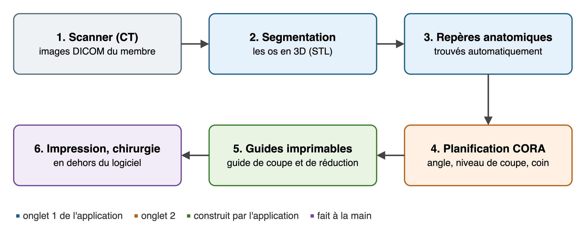
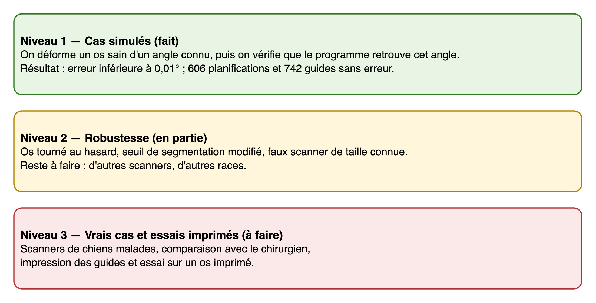

# Contexte

Certains chiens ont un fémur ou un tibia tordu : on parle de **déformité angulaire**. C'est le cas, par exemple, du
fémur arqué qui accompagne souvent la luxation de la rotule chez les petites races, ou du tibia tordu du teckel
(« pes varus »). Quand la déformité gêne le chien, le chirurgien fait une **ostéotomie** : il coupe l'os, le redresse,
puis le fixe avec une plaque.

Pour savoir où couper et de combien redresser, le chirurgien utilise la **méthode CORA** de Paley. Aujourd'hui, il la
trace à la main sur des radiographies. Le **scanner (CT)** donne l'os en 3D et montre aussi la torsion, qu'une
radiographie montre mal. Grâce à l'impression 3D, on peut aussi fabriquer des **guides moulés sur l'os** du patient,
qui guident la scie et les broches pendant l'opération.

Le projet consiste à faire toute cette chaîne avec un logiciel, du scanner jusqu'aux guides à imprimer.

{width=100%}

# Objectifs

Le logiciel doit :

1. lire un scanner et isoler les os en 3D ;
2. trouver tout seul les repères anatomiques du fémur et du tibia (tête du fémur, condyles, plateau du tibia…) ;
3. mesurer la déformité et planifier la correction par la méthode CORA ;
4. proposer une stratégie chirurgicale (type de coupe, niveau, broches) et expliquer ses choix ;
5. construire un guide de coupe et un guide de réduction prêts à imprimer ;
6. réunir tout cela dans une application simple à installer et à utiliser.

# Utilisateurs

| Qui | Rôle |
|:--------------------------------|:---------------------------------------------------------------------|
| Chirurgien vétérinaire (Anas) | vérifie la planification et décide ; le choix final lui revient |
| Équipe projet | développe le logiciel et le teste |
| Service d'impression 3D | reçoit les fichiers des guides (STL) et les plans |
| Service informatique | installe l'application sur un ordinateur |

# Ce qui est dans le projet, et ce qui n'y est pas

| Dans le projet | Hors du projet |
|:-------------------------------------------------|:-------------------------------------------------|
| le membre arrière du chien : fémur et tibia | l'avant-bras (radius et ulna) |
| une seule zone tordue par os (un seul « apex ») | les os tordus à deux endroits |
| le fémur près du genou et tout le tibia | le haut du fémur (col du fémur, hanche) |
| des coupes droites : coin d'ouverture ou de fermeture | les coupes courbes (ostéotomie en dôme) |
| la correction de l'angle et de la torsion | les tissus mous (muscles, ligaments) |
| les guides imprimables et leurs plans | la plaque sur mesure |

# Besoins

Chaque besoin est vérifié par un test. La dernière colonne donne l'état au 19 octobre 2026.

| N° | Le logiciel doit… | Vérifié par | État |
|:---|:----------------------------------------------|:------------------------------------------|:---------|
| B1 | lire un scanner (format DICOM) et isoler chaque os en 3D (fichier STL) | un faux scanner dont on connaît la forme | fait |
| B2 | reconnaître le fémur, le tibia, la fibula, la rotule… | les trois scanners du lévrier | fait |
| B3 | trouver les repères anatomiques sans aide | un os modèle placé au hasard | fait |
| B4 | mesurer les angles et les comparer aux valeurs normales publiées | les os sains du lévrier | fait |
| B5 | calculer le CORA, l'angle de la déformité et la correction | des déformités simulées | fait |
| B6 | montrer chaque étape à l'écran, avec une explication | les 13 étapes de l'application | fait |
| B7 | choisir le coin, le niveau de coupe et la charnière, en expliquant pourquoi | 606 cas simulés | fait |
| B8 | placer les broches qui guident la correction | broches parallèles après correction | fait |
| B9 | corriger aussi la torsion | une torsion simulée de 15° | fait |
| B10 | construire le guide de coupe et le guide de réduction | contrôles automatiques sur 742 guides | fait |
| B11 | produire les fichiers à imprimer et des plans 2D cotés | fichiers produits | fait |
| B12 | tenir dans une application facile à installer | application macOS autonome | fait (Windows : en partie) |
| B13 | être validé sur de vrais cas et des guides imprimés | comparaison avec le chirurgien | à faire |

# Contraintes

- **Données** : nous avons trois scanners d'un lévrier sain (hanche–genou, genou–cheville, cheville–pied). Nous n'avons
  pas encore de scanner de chien malade : les déformités sont donc **simulées** sur les os sains.
- **Équipe et durée** : trois étudiants, pendant le projet PMD2 **[dates de début et de fin à compléter]**.
- **Logiciels** : uniquement des outils gratuits (Python, JavaScript et leurs bibliothèques), sans licence payante.
- **Matériel** : un ordinateur portable (Mac) ; l'impression 3D est faite par un service extérieur.
- **Cadre** : c'est un prototype de recherche. Il ne doit pas servir sur un animal sans validation par le chirurgien.

# Hypothèses

Ce sont les choix que nous avons faits pour que le projet reste réalisable :

1. un scanner du membre est disponible, avec des coupes fines (1 mm ou moins) ;
2. la surface de l'os trouvée par le logiciel est à moins de 0,5 mm de la vraie surface ;
3. chaque os est formé de deux morceaux droits de part et d'autre d'**une seule** zone tordue (un seul apex) ;
4. **fémur : seulement les déformités près du genou** (zone tordue entre 62 et 82 % de la longueur de l'os) ; le haut
   du fémur (col, hanche) demande une autre opération et sort du projet ;
5. la référence est donnée par les valeurs normales publiées, ou par la patte opposée si elle est saine ;
6. l'os est rigide et la correction se fait en une seule fois pendant l'opération ;
7. les muscles, les ligaments et la plaque ne sont pas modélisés ;
8. seulement des coupes droites (pas de coupe courbe en dôme) ; l'angle et la torsion sont corrigés par un coin
   suivi d'une rotation ;
9. le chien est adulte par défaut (une option existe pour un chien en croissance) ;
10. les voies d'accès chirurgicales et les marges de sécurité sont des choix raisonnés, à valider avec le chirurgien.

# Critères de réussite

| Critère | Objectif | Résultat au 19/10/2026 |
|:-----------------------------------------------|:--------------|:------------------------------|
| angle de la déformité retrouvé (cas simulés) | erreur de 2° au plus | moins de 0,01° |
| position des repères anatomiques | 1,5 mm au plus | 1 mm au plus |
| surface de l'os (faux scanner) | 0,5 mm au plus | 0,16 mm |
| planifications simulées sans erreur | toutes | 606 sur 606 |
| guides simulés sans erreur | tous | 742 sur 742 |
| temps de segmentation d'un scanner | moins de 3 min | 0,5 à 2 min |
| accord avec le chirurgien sur de vrais cas | à définir | à faire |
| guide imprimé, posé et testé | à définir | à faire |

{width=100%}

# Livrables

- L'application **CT-CORA3D** (macOS ; un lanceur existe pour Windows).
- Le code source, avec ses tests.
- Les résultats d'exemple : os du lévrier, guides, plans 2D.
- Trois documents : ce cahier des charges, le rapport de projet et la documentation technique.

# Organisation

| Phase | Contenu | État |
|:-----------------------------|:-------------------------------------------------|:----------|
| 1. Cadrage | méthode, hypothèses, format d'échange entre les parties | fait |
| 2. Segmentation | du scanner aux os en 3D | fait |
| 3. Repères et mesures | repères automatiques, angles, torsion | fait |
| 4. Planification | méthode CORA, stratégie chirurgicale | fait |
| 5. Guides | guides imprimables, plans 2D | fait |
| 6. Application | application de bureau | fait |
| 7. Validation sur simulations | tests et campagnes de simulation | fait |
| 8. Essais réels | guides imprimés, vrais cas avec le chirurgien | à faire |

Répartition prévue entre les trois membres de l'équipe : données et segmentation ; mathématiques de la planification ;
guides et validation **[noms à compléter]**. Les dates des prochaines étapes sont **[à compléter]**.

# Risques principaux

| Risque | Ce que nous faisons |
|:-----------------------------------------------|:----------------------------------------------------------|
| pas de scanner de chien malade | déformités simulées ; demande de cas au référent clinique |
| repères mal placés sur un os très déformé | vérification à l'écran avant de planifier |
| jeu des guides imprimés mal réglé | imprimer d'abord de petites pièces de test |
| pièces déformées par la stérilisation | choisir un matériau qui la supporte (polyamide PA12) |
| le chirurgien préfère une autre stratégie | tous les choix restent modifiables dans l'application |
