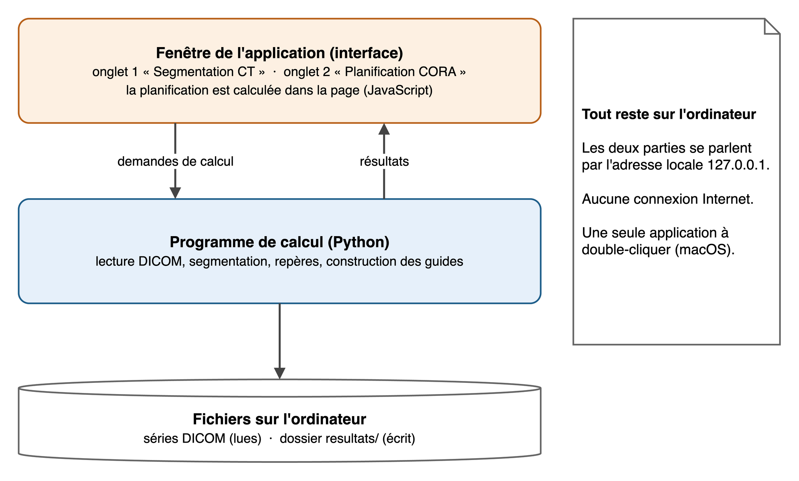
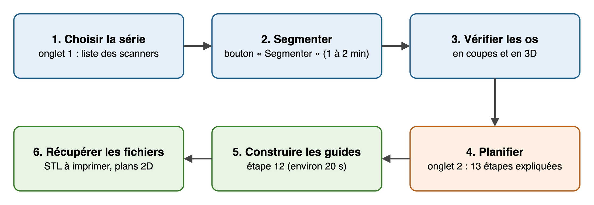
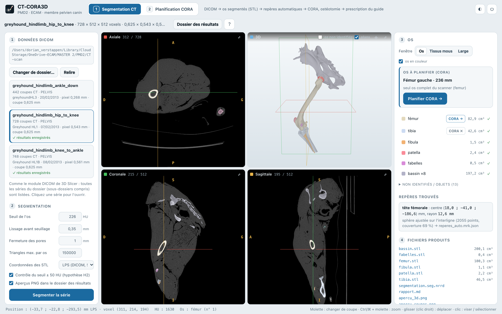

# À quoi sert ce document

Ce document explique comment le logiciel CT-CORA3D est organisé, comment l'installer, l'utiliser, le tester et le
mettre à jour, et quelles données il manipule. Il s'adresse au service informatique et à toute personne qui reprend le
code. Le fonctionnement médical (méthode CORA, stratégie chirurgicale, guides) est expliqué dans le rapport de projet.

# Le logiciel en bref

CT-CORA3D est une **application de bureau**. Elle part du scanner (CT) d'une patte de chien et produit une
planification d'opération et deux pièces à imprimer en 3D.

- **Entrée** : un dossier contenant une série de scanner au format DICOM.
- **Sorties** : des fichiers 3D (STL), des rapports, des images et des plans 2D, rangés dans un dossier `resultats/`.
- **Fonctionnement** : tout se passe sur l'ordinateur. Il n'y a ni serveur distant, ni compte utilisateur, ni base de
  données, et l'application n'a pas besoin d'Internet.
- **Statut** : c'est un prototype de recherche, pas un dispositif médical. Il ne doit pas servir sur un animal sans
  validation par le chirurgien.

# Comment il est organisé

{width=85%}

L'application a deux parties qui tournent sur le même ordinateur :

- **la fenêtre** affiche l'interface. C'est une page web (HTML et JavaScript) dans une vraie fenêtre, grâce à la
  bibliothèque pywebview et au moteur web de macOS. La planification CORA est calculée directement dans cette page ;
- **le programme de calcul**, écrit en Python, fait les calculs lourds : lecture du scanner, segmentation, repères et
  construction des guides. Il fonctionne comme un petit serveur web local : la fenêtre lui envoie ses demandes à
  l'adresse `127.0.0.1`, qui n'est accessible que depuis l'ordinateur lui-même. Il fait un seul calcul à la fois.

Sur Mac, ces deux parties sont dans **une seule application** (fichier `CT-CORA3D.app`). Au lancement, elle démarre deux
processus, la fenêtre et le calcul, car la fenêtre et la bibliothèque 3D VTK ont chacune besoin du fil principal du
programme. Quand on ferme la fenêtre, le programme de calcul s'arrête aussi.

## Les dossiers du projet

| Dossier | Contenu |
|:------------------------|:---------------------------------------------------------------------------|
| `application/` | la fenêtre, le serveur local, l'interface et les scripts qui fabriquent l'application |
| `code_source/` | les calculs en Python (étapes 1 à 7), les tests, et la planification en JavaScript (`cora/`) |
| `resultats/` | les résultats de chaque scanner, un dossier par série |
| `documents/` | cette documentation, le rapport et le cahier des charges |

## Les étapes du calcul

| Fichier (dans `code_source/`) | Rôle |
|:--------------------------------|:----------------------------------------------------------------|
| `etape1_lecture_dicom.py` | lit les fichiers DICOM et reconstruit le volume du scanner |
| `etape2_segmentation.py` | sépare les os (seuil, noyaux, croissance de région) |
| `etape3_identification.py` | donne un nom à chaque os (fémur, tibia, fibula…) |
| `etape4_maillage.py` | fabrique un fichier STL fermé par os |
| `etape5_controle.py` | vérifie la qualité et écrit les rapports |
| `etape6_reperes.py` | trouve les repères anatomiques du fémur et du tibia |
| `etape7_guide.py` et `dessin_guide.py` | construisent les guides et dessinent les plans 2D |
| `parametres.py` | tous les réglages, chacun avec son origine |
| `cora/app/cora_simple.js` | la planification CORA (JavaScript) |

# Installation

## Ce qu'il faut

| Élément | Application Mac (conseillée) | Version de développement (Mac ou Windows) |
|:---------------|:------------------------------------------|:------------------------------------------|
| système | macOS 12 ou plus récent, processeur Apple (M1 à M5) | macOS 12 ou plus, Windows 10 ou 11 |
| logiciels | rien à installer | Python 3.10 ou plus récent |
| mémoire | 16 Go conseillés | 16 Go conseillés |
| disque | 0,8 Go pour l'application, plus environ 0,5 Go par scanner | environ 1 Go pour les bibliothèques Python |
| Internet | inutile | seulement au premier lancement |
| droits | aucun droit administrateur | aucun droit administrateur |

## Installer l'application Mac

1. Copier `CT-CORA3D.app` dans le dossier **Applications** de l'utilisateur (`~/Applications`).
2. Double-cliquer dessus. L'écran « Démarrage des calculs… » s'affiche quelques secondes (4 à 8 s), puis l'application.
3. Si macOS refuse d'ouvrir l'application (elle n'est pas signée par un développeur Apple) : ouvrir **Réglages
   Système → Confidentialité et sécurité**, puis cliquer sur **Ouvrir quand même**.
4. Quand macOS demande l'accès aux dossiers Documents, OneDrive ou à une clé USB, accepter : l'application doit lire les
   scanners et écrire ses résultats.

Par défaut, l'application lit les scanners du dossier `CT-scan/` placé à côté du projet (le bouton « Changer de
dossier… » en choisit un autre) et écrit dans le dossier `resultats/` du projet. Sur un autre Mac, elle écrit dans
`~/Documents/CT-CORA3D`.

## Refaire l'application après une modification du code

L'application contient une copie du code : après chaque modification, il faut la refaire. Dans le Terminal, depuis le
dossier du projet :

```
bash application/lanceurs/creer_app_autonome.sh
```

Cela prend environ 5 minutes la première fois, puis 2 à 3 minutes. Les fichiers temporaires vont dans
`~/Library/Caches/CTCORA3D`, en dehors de OneDrive.

## Windows

Double-cliquer sur `Lancer sur Windows.bat`. Python 3.10 ou plus récent doit être installé. Au premier lancement, les
bibliothèques sont téléchargées (Internet nécessaire, quelques minutes). Si Windows affiche un avertissement
SmartScreen : **Informations complémentaires → Exécuter quand même**. Il n'existe pas encore d'application autonome pour
Windows.

# Utilisation

{width=100%}

1. Dans l'onglet **« Segmentation CT »**, choisir la série dans la liste, puis cliquer sur **« Segmenter la série »**
   (30 secondes à 2 minutes).
2. Vérifier les os en coupes et en 3D. Si deux os sont collés ou mal nommés, utiliser « Renommer » ou « Séparer… ».
3. La carte « Os à planifier » propose le fémur ou le tibia complet de la série : cliquer sur **« Planifier CORA »**.
4. Dans l'onglet **« Planification CORA »**, suivre les 13 étapes. À l'étape 12, cliquer sur **« Construire les guides
   3D »** (environ 20 secondes).
5. Télécharger les fichiers à imprimer, ou ouvrir le dossier des résultats.

Pour quitter : bouton « Quitter » en haut à droite, ou fermer la fenêtre.

{width=100%}

# Fichiers produits

Pour chaque scanner, le logiciel crée un dossier `resultats/<nom de la série>/` :

| Fichier | Contenu |
|:--------------------------------|:--------------------------------------------------------------|
| `femur.stl`, `tibia.stl`… | un fichier 3D par os, en millimètres |
| `segmentation.seg.nrrd` | la segmentation complète (s'ouvre dans le logiciel 3D Slicer) |
| `rapport.md`, `rapport.json` | le rapport de la segmentation |
| `apercu_3d.png`, `apercu_coupes.png` | des images pour vérifier rapidement |
| `cora_femur.json`, `cora_tibia.json` | les repères, les angles et la torsion de l'os |
| `guide_<os>_<coin>/` | les guides : `guide_coupe.stl` et `guide_reduction.stl` (à imprimer), plans 2D (PDF, SVG, PNG), `guide.json` (contrôles et mode opératoire) |

Il n'y a pas de base de données : pour sauvegarder un cas, il suffit de copier son dossier. Le journal de
l'application est dans `~/Library/Logs/CTCORA3D.log`.

# Tests

Le projet contient des tests automatiques. Ils se lancent dans le Terminal, avec le Python du projet (dans
`code_source/`) ou avec Node.js (dans `code_source/cora/`).

| Commande | Ce qu'elle vérifie | Résultat du 19/10/2026 |
|:-------------------------------------|:---------------------------------------------|:----------------------|
| `python tests/test_chaine.py` | lecture et segmentation d'un faux scanner de forme connue | 14 contrôles sur 14 (2 s) |
| `python tests/test_reperes.py` | repères sur un os placé au hasard et sur les os réels | 40 sur 40 (13 s) |
| `python tests/test_guide.py` | construction et contrôle des guides | tous réussis (56 s) |
| `node tests/test_cas.mjs` | planification sur l'os modèle (264 cas) | tous réussis (8 s) |
| `node tests/test_reel.mjs` | planification sur les os du lévrier | tous réussis (15 s) |
| `node tests/campagne_strategie.mjs` | 606 stratégies simulées, 9 règles | 0 erreur |
| `python tests/campagne_guides.py` | 102 guides simulés et contrôlés | 0 erreur |

Les durées ont été mesurées sur un Mac Apple M5 avec 16 Go de mémoire. Autres temps utiles : segmentation d'un scanner
de 30 s à 2 min ; repères 1,3 s par os ; construction des deux guides 22 s en moyenne.

# Technologies et licences

| Outil | Rôle | Licence |
|:----------------------|:---------------------------------------------------|:----------------|
| Python 3.14 | langage des calculs | PSF (libre) |
| numpy, scipy | calcul numérique | BSD |
| pydicom | lecture des fichiers DICOM | MIT |
| SimpleITK | traitement d'images (segmentation) | Apache 2.0 |
| VTK, pyvista | surfaces 3D | BSD, MIT |
| trimesh, manifold3d | maillages et découpes exactes des guides | MIT, Apache 2.0 |
| matplotlib | images et plans 2D | type PSF (libre) |
| pywebview | fenêtre de l'application | BSD |
| Three.js | affichage 3D dans l'interface | MIT |
| PyInstaller | fabrication de l'application Mac (pas inclus au lancement) | GPL avec exception |

Toutes ces bibliothèques sont gratuites et libres ; leurs licences permettent d'utiliser et de distribuer
l'application. La licence du code du projet reste à choisir **[à compléter]**.

# Données et sécurité

- **Tout reste sur l'ordinateur.** Le serveur local n'écoute que l'adresse `127.0.0.1` (vérifié) : il n'est pas
  accessible depuis le réseau. L'application n'envoie rien sur Internet.
- **Les scanners peuvent contenir des noms.** L'en-tête d'un fichier DICOM contient souvent le nom de l'animal, parfois
  celui de son propriétaire, et un identifiant. Le logiciel recopie ce nom et cet identifiant dans `rapport.md`,
  `rapport.json` et dans le journal. Il vaut donc mieux **rendre les scanners anonymes** avant de les importer (avec
  l'outil de la clinique), et nommer les dossiers par un code (par exemple `CAS_001`).
- **OneDrive.** Le projet est dans un dossier OneDrive : tout ce qui s'y trouve est copié sur les serveurs de l'école.
  C'est acceptable pour les données d'exemple ; pour de vrais cas cliniques, demander l'accord de l'établissement ou
  travailler dans un dossier qui n'est pas synchronisé.
- **Les fichiers à imprimer** (STL) ne contiennent que la forme des pièces, aucune information sur l'animal.

**Améliorations possibles.** Le serveur local accepte aujourd'hui les demandes sans vérifier d'où elles viennent : une
page web ouverte sur le même ordinateur pourrait, en théorie, lui envoyer une commande. Il faudrait ajouter un contrôle
de l'origine des demandes et un mot de passe tiré au démarrage. Il faudrait aussi arrêter de recopier le nom de
l'animal dans les rapports, et signer l'application avec un compte développeur Apple avant de la diffuser.

# Problèmes fréquents

| Problème | Solution |
|:----------------------------------------------|:------------------------------------------------------------|
| macOS refuse d'ouvrir l'application | Réglages Système → Confidentialité et sécurité → Ouvrir quand même |
| la liste des scanners est vide | autoriser l'accès au dossier (Réglages Système → Confidentialité → Fichiers et dossiers), ou choisir un autre dossier |
| « Un calcul est en cours » | attendre la fin : un seul calcul à la fois |
| un os est marqué « CORA × » | l'os est coupé par le bord du scanner ; il faut un scanner qui montre les deux articulations |
| deux os sont collés ou mal nommés | utiliser « Renommer » ou « Séparer… » dans l'onglet 1 |
| la construction des guides échoue | lire le message ; changer le type de coin, le niveau de coupe ou les broches |
| autre problème | lire le journal `~/Library/Logs/CTCORA3D.log` |

# Limites techniques

- L'application autonome existe seulement pour Mac avec processeur Apple ; sous Windows, il faut la version de
  développement.
- Elle fait un seul calcul à la fois.
- Elle doit être refaite après chaque modification du code.
- Elle n'est pas signée par un développeur Apple : macOS demande une confirmation au premier lancement.
