# Introduction

## Le problème médical

Chez le chien, il arrive qu'un os de la patte arrière pousse de travers. Le fémur ou le tibia prend alors une forme
courbée : on parle de **déformité angulaire**. Les cas les plus fréquents sont :

- le fémur courbé vers l'intérieur, souvent associé à la luxation de la rotule chez les petites races ;
- le fémur courbé vers l'extérieur chez les grandes races ;
- le tibia tordu du teckel, appelé « pes varus », souvent avec une torsion ;
- un tibia trop incliné vers l'avant ou vers l'arrière.

Une déformité peut faire boiter le chien, user ses articulations ou faire sortir sa rotule de sa place. Pour la
corriger, le chirurgien fait une **ostéotomie** : il coupe l'os, remet le morceau du bas dans la bonne direction et le
fixe avec une plaque vissée. Tout l'enjeu est de savoir **où couper, comment couper et de combien tourner**.

## Pourquoi un scanner et des guides imprimés

La méthode de référence pour préparer une ostéotomie est celle de Paley [1]. Le chirurgien trace des lignes sur deux
radiographies (une de face, une de profil) et en déduit l'endroit où couper. Cette méthode a deux limites : elle se
fait à la main, et une radiographie montre mal la **torsion** de l'os (quand l'os est « vrillé » sur lui-même).

Le **scanner** (CT, pour *computed tomography*) donne l'os en trois dimensions. On voit sa vraie forme et on peut mesurer
la torsion. De plus, l'impression 3D permet maintenant de fabriquer des **guides patient-spécifiques** : des pièces
en plastique moulées sur l'os du patient, qui guident la scie et les broches pendant l'opération. Plusieurs équipes
vétérinaires les utilisent déjà, avec une précision d'environ 2° [10, 12, 13]. Mais la préparation de ces guides se fait
encore à la main, dans des logiciels de conception.

## Objectif du projet

Notre objectif est de faire **toute la chaîne automatiquement**, du scanner jusqu'aux guides prêts à imprimer, en
montrant et en expliquant chaque étape. Concrètement, le logiciel doit :

1. isoler les os du scanner en 3D ;
2. trouver les repères anatomiques du fémur et du tibia ;
3. mesurer la déformité et calculer la correction avec la méthode CORA ;
4. choisir une stratégie chirurgicale (type de coupe, niveau, broches) et dire pourquoi ;
5. construire un guide de coupe et un guide de réduction, et vérifier qu'ils fonctionnent ;
6. être réuni dans une application simple à utiliser.

Le choix final reste toujours au chirurgien : le logiciel propose et explique, il ne décide pas à sa place.

## Plan du rapport

Nous expliquons d'abord les notions utiles (partie 2) et notre démarche (partie 3). Les parties 4 à 9 suivent le
chemin d'un cas : du scanner aux os en 3D, les repères, la planification, la stratégie, les guides, puis
l'application. La partie 10 présente nos résultats, la partie 11 les limites, et la partie 12 la suite du projet.

# Les notions à connaître

## Décrire une déformité

On regarde l'os dans trois directions :

- **de face** (plan frontal) : l'os peut être courbé vers l'intérieur (*varus*) ou vers l'extérieur (*valgus*) ;
- **de profil** (plan sagittal) : il peut être courbé vers l'avant (*procurvatum*) ou vers l'arrière (*recurvatum*) ;
- **en torsion** (plan transverse) : le bas de l'os peut être tourné par rapport au haut.

Pour mesurer, on utilise des **angles articulaires** : l'angle entre la ligne d'une articulation (par exemple la ligne
qui touche le bas des deux condyles du fémur) et l'axe de l'os. Chez un chien sain, ces angles ont des valeurs
connues, publiées pour plusieurs races [2–5]. Par exemple, l'angle aLDFA du fémur vaut environ 94° ± 3°. Un angle qui
s'écarte de plus de deux écarts-types de la valeur normale signale une déformité.

## La méthode CORA

La méthode CORA de Paley [1] est simple dans son principe (figure ci-dessous). On considère que l'os déformé est fait
de deux morceaux droits. Chaque morceau a son axe. Les deux axes se croisent en un point : le **CORA** (*center of
rotation of angulation*). L'angle entre les deux axes est l'**angle de la déformité**, noté θ.

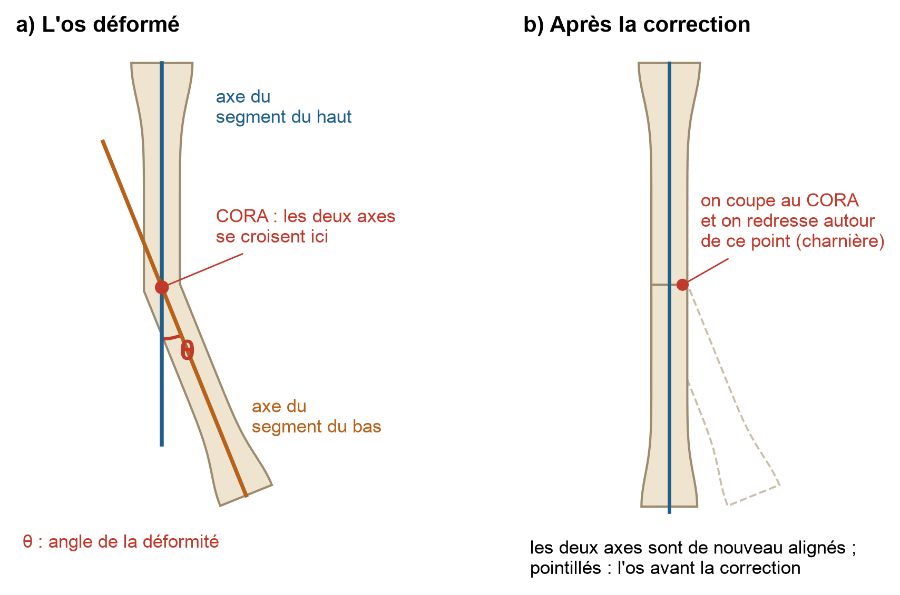{width=100%}

Si l'on coupe l'os au niveau du CORA et que l'on tourne le morceau du bas de l'angle θ autour de ce point, l'os
redevient droit et ses deux morceaux restent bien alignés. C'est la **règle 1** de Paley. Si on ne peut pas couper au
CORA (par exemple parce qu'il est trop près de l'articulation), on coupe un peu plus loin et on fait glisser le morceau
du bas pour le réaligner : c'est la **règle 2**.

En 3D, une déformité a souvent une composante de face **et** une composante de profil. Elle se trouve alors dans un
plan « oblique ». L'angle vrai n'est pas la somme des deux : pour 15° de face et 10° de profil, l'angle vrai vaut
17,8°, et non 25° [6]. Corriger les deux vues l'une après l'autre reviendrait à mal corriger.

## Couper : coin de fermeture ou coin d'ouverture

Pour redresser l'os, on peut faire deux types de coupes (figure ci-dessous) :

- le **coin de fermeture** : on fait deux traits de scie et on retire un petit coin d'os du côté bombé ; on referme
  ensuite l'os. Les deux morceaux restent en contact, ce qui est stable, mais l'os raccourcit un peu ;
- le **coin d'ouverture** : on fait un seul trait de scie du côté creux et on ouvre l'os. Il s'allonge un peu, mais il
  reste un espace vide qui doit se combler.

Dans les deux cas, on garde un petit pont d'os intact de l'autre côté : la **charnière**. Les deux morceaux tournent
autour d'elle. La scie entre donc toujours du côté opposé à la charnière, et c'est de ce côté que le guide se pose.

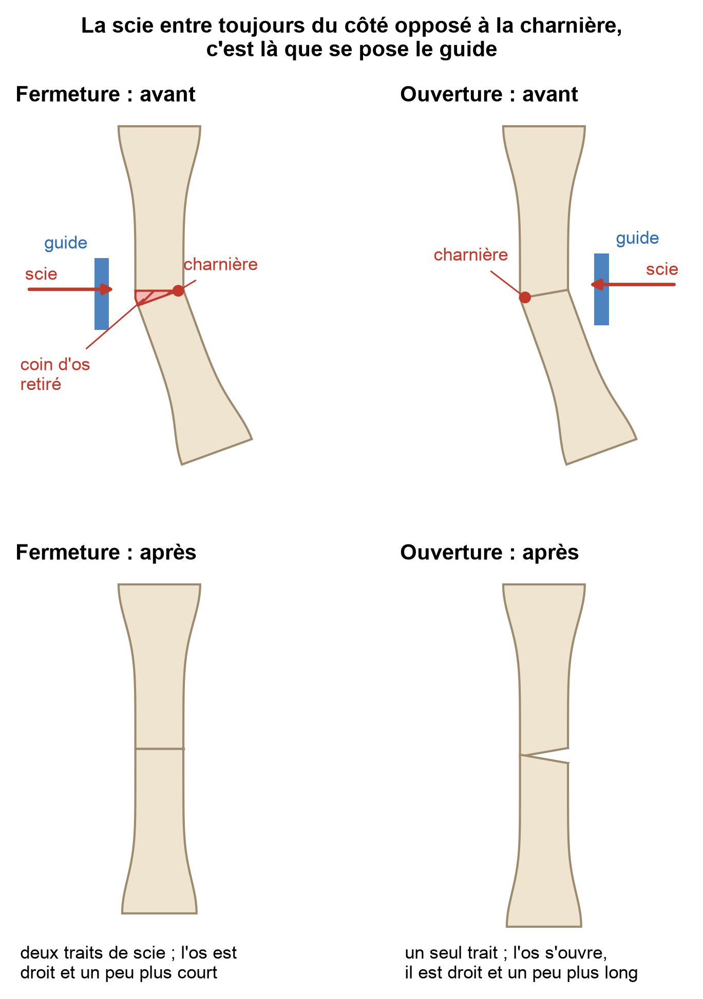{width=82%}

## Les guides imprimés dans la littérature

Le tableau suivant résume ce qui a été publié sur les guides imprimés chez le chien. Ces résultats portent sur toute la
chaîne : préparation, guide et opération.

| Étude | Os opérés | Résultat |
|:----------------------|:--------------------------|:--------------------------------------------------------------|
| Worth 2019 [9] | avant-bras | guides de coupe seuls : 1 patte sur 7 réopérée à cause d'une torsion mal corrigée |
| Hall 2019 [10] | fémur (luxation de rotule) | torsion finale à 1,7° ± 2,1° de l'objectif |
| De Armond 2022 [11] | avant-bras | plus de 90 % des mesures à moins de 5° et 5 mm de l'objectif |
| Jeon 2023 [12] | tibia de petites races | erreur de 1,8° à 2,6° selon le plan |
| Bright 2024 [13] | tibia du teckel | erreur de moins de 2° et 1 mm |

Ce tableau nous apprend deux choses. Un guide de coupe seul ne suffit pas à bien contrôler la torsion. Un **guide de
réduction**, qui s'enfile sur des broches après la coupe, permet de remettre l'os exactement à la bonne place. Notre
logiciel construit donc les deux.

# Notre démarche

## Du cadrage au logiciel

Au début, le projet partait de deux radiographies. Nous avons vite vu que la torsion restait invisible. Le 5 octobre
2026, un document de cadrage [18] a fixé la nouvelle direction : partir du **scanner**, traiter le **membre arrière**
(fémur et tibia) et toutes les composantes de la déformité. Il a aussi découpé le projet en deux parties reliées par un
fichier d'échange (au format JSON) :

- **partie 1** : du scanner à une « prescription » qui dit où couper et comment corriger ;
- **partie 2** : de cette prescription aux guides à imprimer.

Ce fichier d'échange permet de travailler sur les deux parties en même temps. Nous avons d'abord fait deux prototypes
séparés (un pour la segmentation, un pour la planification), puis nous les avons réunis dans une seule application :
CT-CORA3D (figure ci-dessous).

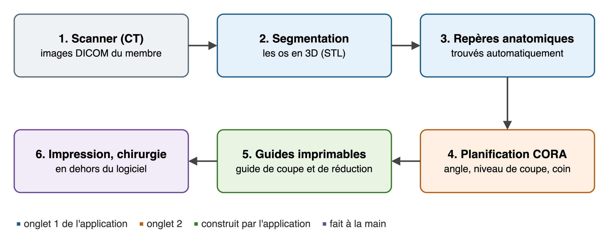{width=100%}

## Tester sur des cas dont on connaît la réponse

Nous n'avons pas encore de scanner de chien malade. Nous avons trois scanners d'un **lévrier sain** (de la hanche au
genou, du genou à la cheville, et le pied). Pour tester le logiciel, nous avons donc **simulé** des déformités : on prend
un os sain, on le « tord » d'un angle connu, puis on vérifie que le logiciel retrouve cet angle et sait le corriger.
Comme on connaît la bonne réponse, on peut mesurer l'erreur exactement.

Nous avons aussi lancé des **campagnes de simulation** : des centaines de cas différents, contrôlés automatiquement
par des règles écrites à l'avance (par exemple « le guide n'est jamais posé du côté de la charnière »).

## Outils

Le logiciel est écrit en **Python** pour les calculs lourds (images du scanner, maillages 3D, guides) et en
**JavaScript** pour l'interface et la planification, qui doivent réagir tout de suite. Nous n'utilisons que des
bibliothèques gratuites. L'ensemble représente environ 15 000 lignes de code, dont environ 1 700 lignes de tests.

# Étape 1 — Du scanner aux os en 3D

## Lire le scanner

Un scanner est une pile d'images en coupe (ici, entre 442 et 748 coupes de 0,625 mm d'épaisseur). Chaque pixel a une
valeur en **unités Hounsfield** (HU) : plus l'os est dense, plus la valeur est grande. Le logiciel lit les fichiers au
format DICOM, les range dans le bon ordre grâce à leur position dans l'espace, et calcule où se trouve chaque pixel
en millimètres.

## Séparer les os

La segmentation consiste à trouver quels pixels appartiennent à quel os. On garde d'abord tout ce qui dépasse 226 HU
(la densité typique de l'os). Le problème, c'est qu'à ce seuil tous les os se touchent : au niveau des articulations,
quelques pixels les relient (image 2 ci-dessous).

Notre astuce : on **monte le seuil** petit à petit, de 500 à 1500 HU. L'articulation, moins dense que l'os, disparaît
avant lui. Il reste alors un « noyau » dense par os (image 3). Chaque noyau sert de point de départ, et on le fait
grandir dans le masque à 226 HU, en commençant par les pixels les plus denses. Deux os qui grandissent se rencontrent
dans l'articulation, là où la densité est la plus faible (image 4).

{width=100%}

La hanche est plus difficile : la tête du fémur reste collée au bassin. Le logiciel cherche donc la **sphère** formée
par la tête du fémur et s'en sert pour séparer le fémur du bassin.

## Nommer les os et fabriquer les fichiers 3D

Ensuite, des règles anatomiques simples donnent un nom à chaque os. Par exemple : le tibia et la fibula sont deux os
longs côte à côte ; le fémur est l'os qui porte une tête sphérique ; la rotule est un petit os collé au fémur.

Chaque os est enfin transformé en surface 3D fermée (un fichier **STL**, le format utilisé pour l'impression 3D).
Pour que cette surface soit précise, le logiciel déplace chaque point jusqu'au milieu de la transition entre l'os et
les tissus autour.

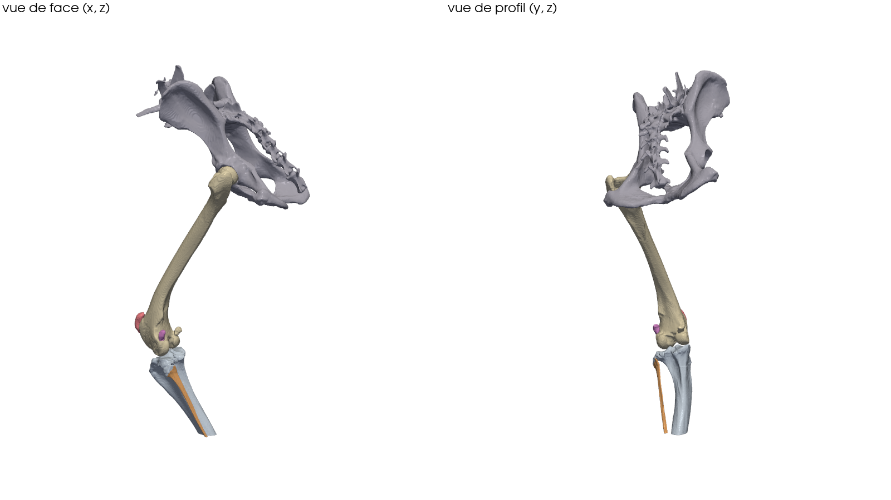{width=90%}

## Vérifier la précision

Pour vérifier, nous avons fabriqué un **faux scanner** : des os de forme connue, écrits au format DICOM. Avec un
simple seuil, la surface trouvée est 0,60 mm trop grande. Après le recalage de la surface, l'écart n'est plus que de
0,16 mm. Sur le lévrier, nous avons aussi changé le seuil de ± 50 HU : la surface du fémur et du tibia bouge en
moyenne de 0,2 mm, et de 0,5 mm au plus pour 95 % des points. Les petits os fins (fibula, talus) sont plus sensibles.
Segmenter un scanner prend entre 30 secondes et 2 minutes.

# Étape 2 — Les repères anatomiques

Pour mesurer les angles, il faut des **repères** : le centre de la tête du fémur, les points les plus bas des
condyles, le sommet du plateau du tibia, les malléoles, etc. Habituellement, on les place à la main. Notre logiciel les
trouve tout seul, en 1,3 seconde par os.

Il commence par orienter l'os : il trouve son axe long, puis le haut et le bas (la tête du fémur, ou la partie la plus
large du tibia), et l'avant et l'arrière (par exemple la crête du tibia). Il en déduit si c'est une patte gauche ou
droite. Il cherche ensuite chaque repère par une règle géométrique, comme le ferait le chirurgien avec une règle posée
sur la radiographie. Un os coupé par le bord du scanner est refusé : il faut les deux articulations pour la méthode
CORA.

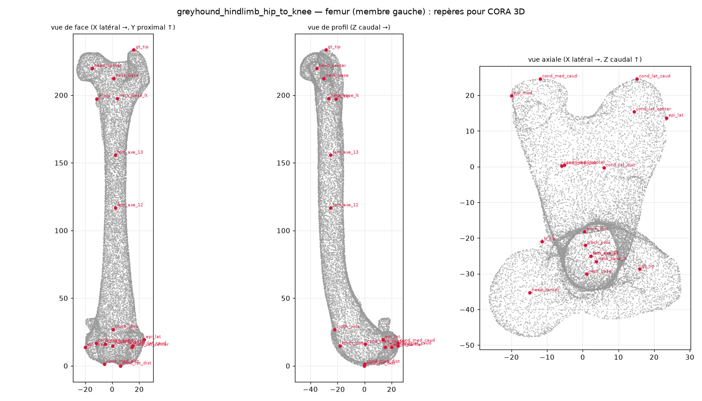{width=95%}

**Vérification.** Nous avons pris l'os modèle d'un prototype précédent, dont nous connaissons les repères exacts, et
nous l'avons placé au hasard dans quatre positions. Le logiciel trouve les mêmes repères dans les quatre positions, à
moins de 1 mm des vrais, et les angles de face à moins de 1,3°. Sur le lévrier, tous les angles du fémur et du tibia
tombent dans les valeurs normales publiées, ce qui est attendu pour un chien sain.

**Un piège : 2D contre 3D.** Les valeurs normales publiées sont mesurées sur des radiographies. Notre logiciel mesure en
3D, avec ses propres repères. Les deux définitions ne donnent pas exactement le même angle. Nous avons donc mesuré cet
écart une fois sur un os sain, et nous l'ajoutons aux valeurs publiées avant de comparer.

# Étape 3 — La planification CORA

## Le calcul

Le logiciel construit l'axe de chaque morceau de l'os à partir des lignes articulaires, de face et de profil, puis en
3D. En 3D, deux axes ne se croisent presque jamais exactement : ils passent l'un à côté de l'autre. Le logiciel cherche
alors la plus petite distance entre eux ; le CORA est au milieu. Il calcule ensuite :

- l'**angle vrai** θ entre les deux axes ;
- le **plan de la déformité**, c'est-à-dire la direction dans laquelle l'os est courbé ;
- l'**axe de correction**, autour duquel il faut tourner le morceau du bas.

Si la torsion est anormale, il ajoute une **dérotation** : une rotation du morceau du bas autour de son propre axe,
calculée pour retrouver une torsion normale.

## Treize étapes expliquées

Dans l'application, la planification se fait en 13 étapes. Chacune montre l'os en 3D, avec un texte qui explique ce
qui se passe :

- étape 1 : le cas (l'os, ses repères, le dépistage des angles) ;
- étapes 2 à 4 : la vue de face (lignes articulaires, angles, axes et CORA) ;
- étapes 5 et 6 : la vue de profil (lignes, angles, axes et CORA) ;
- étapes 7 et 8 : la 3D (angle vrai, plan de la déformité, axe de correction) ;
- étapes 9 à 11 : l'ostéotomie (traits de coupe, correction animée, contrôle des angles) ;
- étape 12 : les guides de coupe et de réduction ;
- étape 13 : la torsion.

On peut travailler sur un os segmenté, ou sur un **os modèle** sur lequel on choisit la déformité (17 cas cliniques
sont prêts à l'emploi). Sur un os sain segmenté, on peut aussi imposer une « déformité de test » pour s'entraîner.

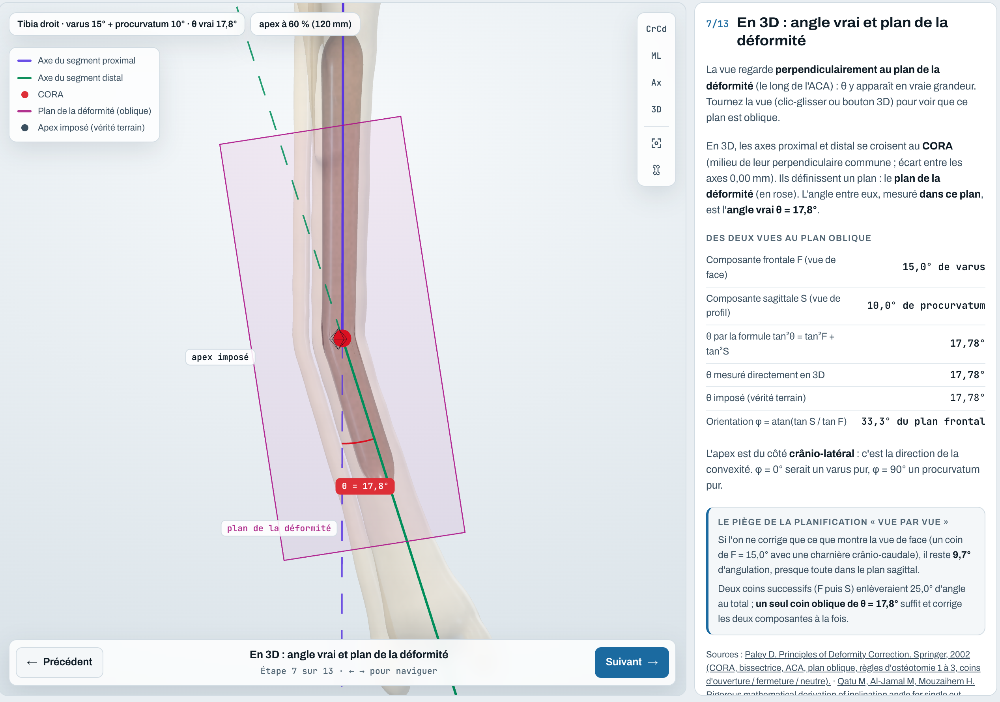{width=95%}

## Résultats

Sur l'os modèle (264 déformités différentes), le logiciel retrouve l'angle de la déformité avec une erreur maximale de
0,0065°. Sur le fémur et le tibia du lévrier, avec des déformités imposées, l'erreur est inférieure à 0,0001°. Après la
correction simulée, les angles reviennent à ceux de l'os sain (écart inférieur à 0,005°), et une torsion de 15° est
corrigée exactement.

Un dernier résultat est intéressant. Si on prend comme référence les valeurs normales **publiées** au lieu de l'os sain
du même chien, l'écart monte à 2,6° pour le fémur et à 5,2° pour le tibia. Ce n'est pas une erreur du calcul : ce
lévrier, bien que sain, a des angles un peu différents de la moyenne publiée. Quand c'est possible, il vaut donc mieux
comparer avec la patte opposée du même chien.

# Étape 4 — La stratégie chirurgicale

La géométrie ne suffit pas : il faut aussi choisir comment opérer. Le logiciel propose une stratégie et explique chaque
choix. Le chirurgien peut tout modifier.

## Où poser le guide

La scie entre du côté opposé à la charnière, et le guide se pose de ce côté. Mais ce côté doit être accessible par une
**voie d'abord** habituelle : au fémur, par le côté extérieur (± 60°) ou, près du genou, par le côté intérieur
(± 45°), jamais par l'avant (muscle quadriceps, rotule) ni par l'arrière (nerf sciatique) ; au tibia, par le côté
intérieur (± 60°) ou extérieur (± 30°). Si le côté idéal n'est pas accessible, le guide peut être décalé de 60° au plus.
Au-delà, ce type de coupe est écarté.

## Ouverture ou fermeture ?

Le logiciel compare les deux coins avec des critères rangés par ordre d'importance (figure ci-dessous). Le premier
critère qui fait la différence décide, et tous restent affichés à l'écran.

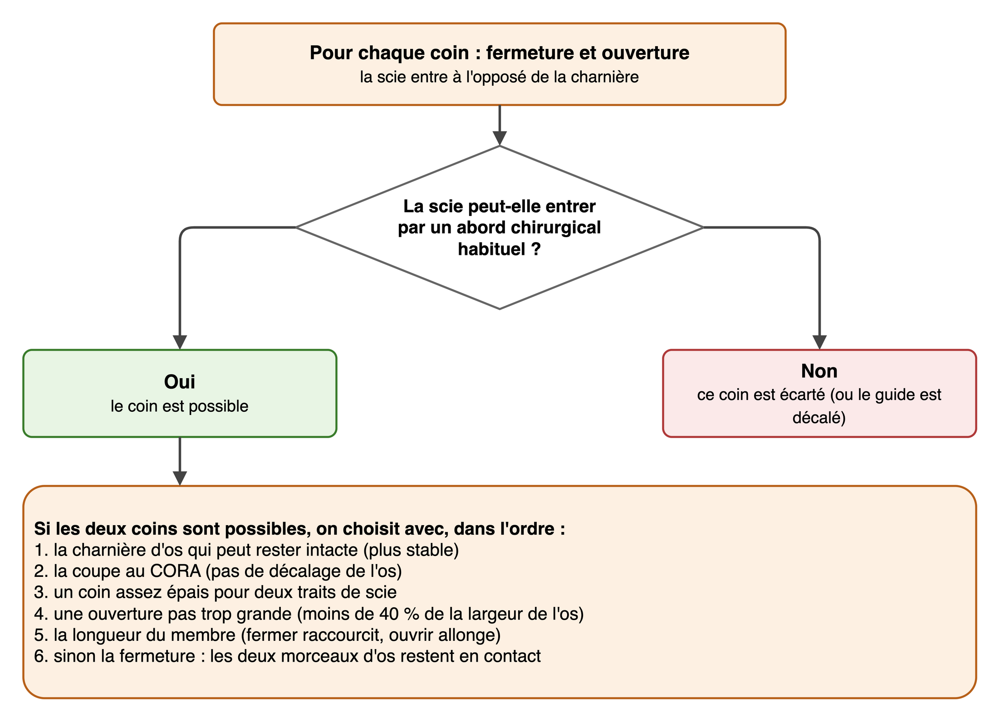{width=82%}

Sur 606 cas simulés, les choix suivent la pratique publiée : au tibia, une courbure vers l'intérieur se corrige plutôt
par ouverture et une courbure vers l'extérieur par fermeture ; au fémur, la fermeture domine [7, 8].

## Niveau de coupe et charnière

Par défaut, la coupe passe au CORA (règle 1). Si un trait de scie passait à moins de 5 mm du cartilage de
l'articulation, le logiciel déplace la coupe vers le milieu de l'os (règle 2) et calcule le glissement nécessaire. La
charnière est placée à 2 mm à l'intérieur de l'os : ce petit pont d'os (3 mm au plus) plie sans casser.

Le logiciel vérifie aussi des distances de sécurité : 5 mm du cartilage, 8 mm de la tubérosité du tibia (où s'attache
le tendon de la rotule), 6 mm des épicondyles du fémur (où s'attachent les ligaments), et au moins 25 mm d'os de chaque
côté pour la plaque et les broches. Pour un chien en croissance, il évite aussi les cartilages de croissance.

## Les broches

Les broches sont de fines tiges métalliques (1,6 mm de diamètre). Elles ont trois rôles : tenir le guide pendant la
coupe, guider la correction et tenir l'os à la fin. L'astuce est la suivante : les broches du bas sont percées avec
**l'angle inverse** de la correction. Quand l'os est bien corrigé, toutes les broches deviennent **parallèles**. Le
chirurgien voit donc tout de suite si la correction est bonne. Par défaut, il y a deux broches par morceau d'os, ce qui
empêche les morceaux de tourner. Le logiciel les place loin du cartilage, des autres os et du trajet de la scie.

# Étape 5 — Les guides imprimables

## Deux pièces complémentaires

Le logiciel construit deux pièces (figure ci-dessous) :

- le **guide de coupe**, posé sur l'os pendant l'opération. Il est moulé sur l'os, ce qui ne lui laisse qu'une seule
  position possible. Il porte une ou deux fentes pour la scie et quatre trous pour les broches. Il est fait de deux
  moitiés reliées par deux petits ponts : après la coupe, on coupe les ponts et chaque moitié sort en glissant le long de
  ses broches ;
- le **guide de réduction**, posé après la coupe. Il s'enfile sur les quatre broches, mais seulement si elles sont
  parallèles, c'est-à-dire si l'os est bien corrigé. Il tient ensuite l'os pendant la pose de la plaque.

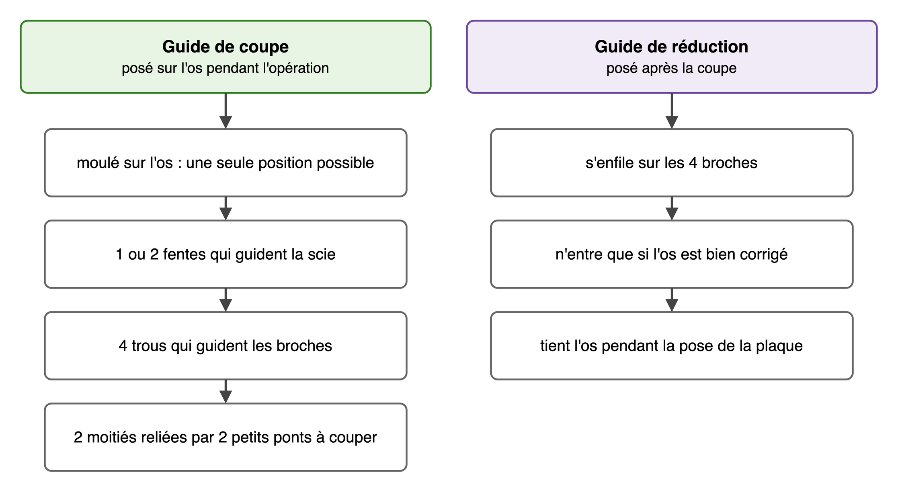{width=90%}

## Comment le logiciel les construit

Le logiciel découpe l'espace autour de l'os en petits cubes de 0,3 mm et calcule, pour chacun, sa distance à l'os. Le
guide est la zone qui se trouve entre 0,3 mm et 3,3 mm de l'os (une coque de 3 mm, avec 0,3 mm de jeu), du côté où il
se pose. On y ajoute les blocs qui portent les fentes et les trous. Deux règles sont imposées : le guide ne touche
jamais l'os, et il doit pouvoir se poser et se retirer sans accrocher. Les fentes et les trous sont ensuite taillés de
façon exacte, avec une bibliothèque de calcul 3D (manifold3d). Le guide évite aussi les os voisins (fibula, rotule,
fabelles) et ne repose jamais sur le cartilage.

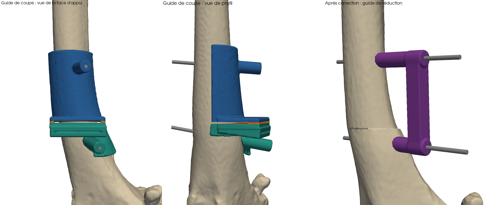{width=100%}

Le guide est **paramétrable** : 21 dimensions (épaisseur, jeu, largeur des fentes, diamètre des broches…) peuvent être
changées dans l'application, dans des limites de sécurité. Les autres dimensions dépendent de l'os et sont recalculées
pour chaque patient.

## Les contrôles automatiques

Chaque guide est vérifié par des mesures indépendantes de sa construction : le jeu avec l'os, l'absence de contact, la
surface d'appui, le retrait de chaque moitié sans heurter l'os, la distance aux os voisins et au cartilage, et la
fermeture du fichier STL (indispensable pour l'imprimer).

## Les plans 2D

Le logiciel dessine aussi un **plan coté** de chaque guide, comme un plan de pièce mécanique : vues de face, de profil
et de dessus, dimensions principales et mode opératoire, sur une feuille A3. Une cote de contrôle de 50 mm permet de
vérifier l'échelle à l'impression.

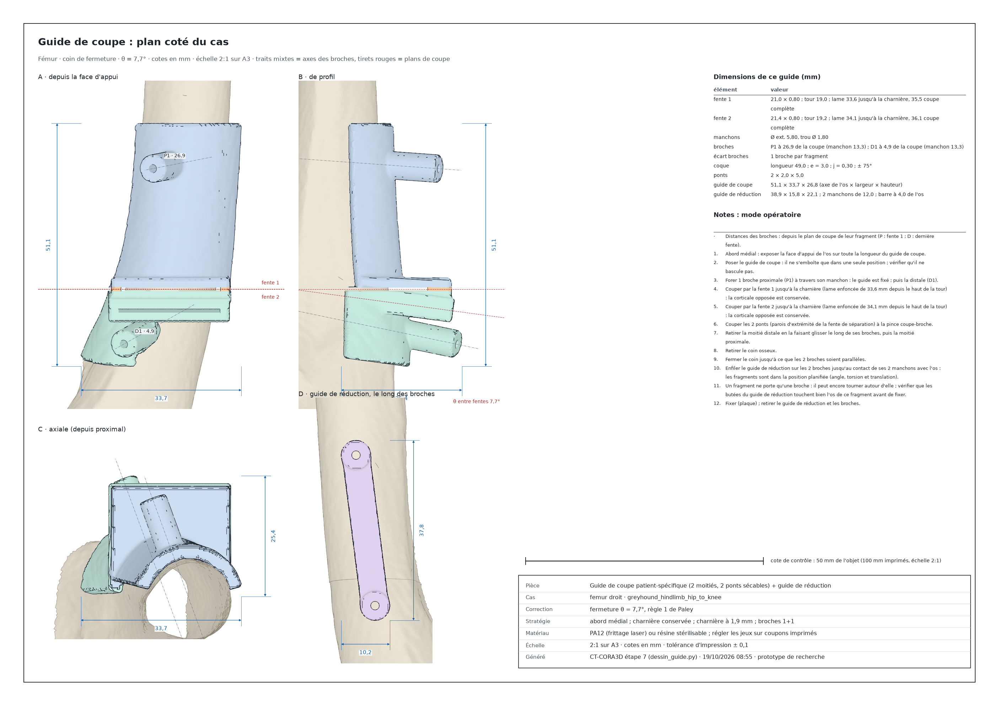{width=100%}

## Au bloc opératoire

La figure ci-dessous résume l'usage prévu des guides pendant l'opération. Ce déroulé n'a pas encore été essayé.

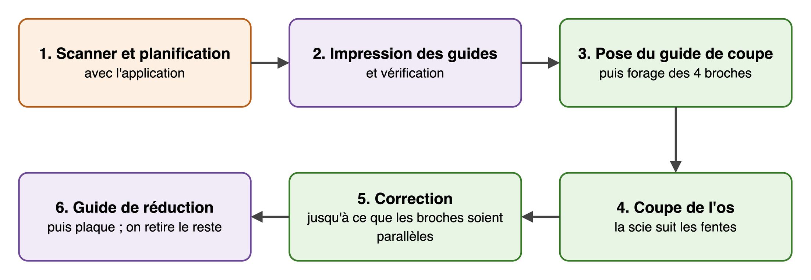{width=100%}

# L'application

Tout le logiciel tient dans une application de bureau avec deux onglets : **« Segmentation CT »** pour le scanner et
les os, et **« Planification CORA »** pour les 13 étapes et les guides. Sur Mac, elle existe sous forme d'application
autonome : on la double-clique, sans rien installer d'autre, et elle démarre en 4 à 8 secondes.

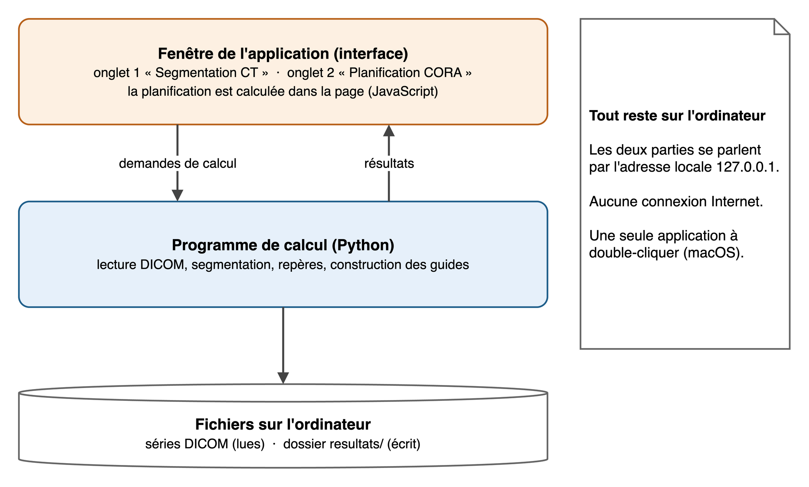{width=85%}

L'interface est une page web affichée dans une vraie fenêtre. Les calculs lourds sont faits par un programme Python sur
le même ordinateur ; les deux parties se parlent par une adresse locale et rien ne passe par Internet. Le détail est
dans la documentation technique.

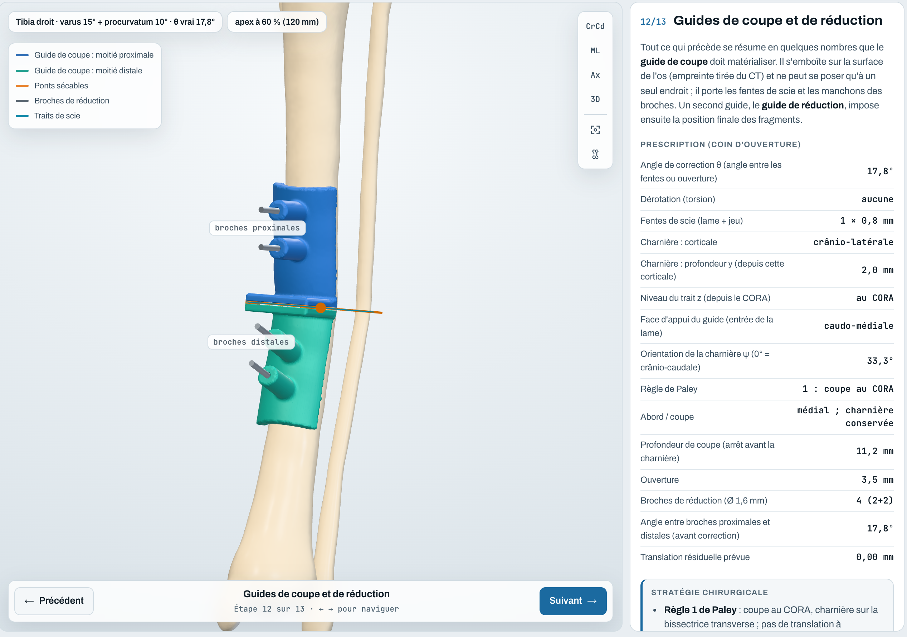{width=95%}

# Résultats et validation

## Trois niveaux de tests

Nous avons suivi trois niveaux de validation (figure ci-dessous). Les deux premiers sont faits ; le troisième reste à
faire.

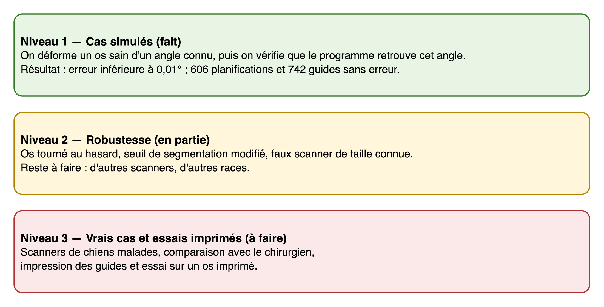{width=100%}

## Les principaux résultats

| Ce que nous avons mesuré | Objectif | Résultat |
|:--------------------------------------------------|:----------------|:-------------------------|
| angle de la déformité retrouvé (os modèle, 264 cas) | 2° au plus | 0,0065° au plus |
| angle de la déformité retrouvé (os du lévrier) | 2° au plus | moins de 0,0001° |
| repères anatomiques | 1,5 mm au plus | 1 mm au plus |
| surface de l'os (faux scanner) | 0,5 mm au plus | 0,16 mm |
| planifications simulées sans erreur | toutes | 606 sur 606 |
| guides simulés sans erreur | tous | 742 sur 742 |
| jeu entre l'os et le guide | 0,30 mm | 0,29 à 0,32 mm |
| temps : segmentation, repères, guides | quelques minutes | 2 min, 1,3 s, 22 s |

La figure suivante compare notre erreur de calcul à ce qui est publié. Elle est si petite qu'elle ne se voit pas sur le
graphique : l'erreur d'une vraie opération viendra surtout d'ailleurs (repères sur un os malade, impression, pose du
guide, geste du chirurgien).

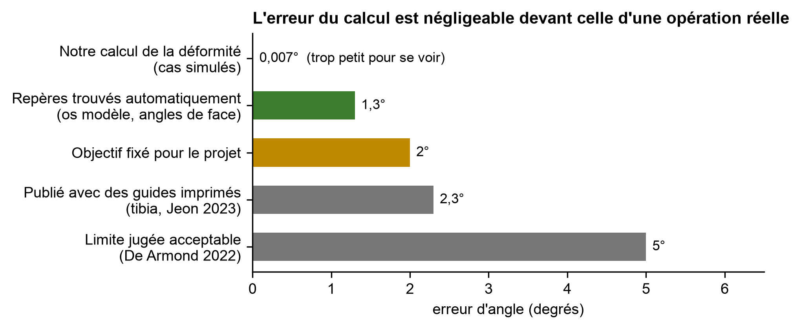{width=100%}

## Une campagne qui a fait progresser le logiciel

Notre première campagne de simulation des guides a été très utile. Au début, seulement 46 cas sur 480 étaient sans
erreur : guide ou broche dans le cartilage, guide qui touche la fibula, broche sur le trajet de la scie… Nous avons
corrigé chaque type d'erreur, puis relancé la campagne sur 640 cas, dont 320 tirés au hasard. Résultat : 640 cas sur
640 sans erreur. Une deuxième campagne de 102 cas, avec toutes les configurations de broches, n'a trouvé aucune
erreur non plus.

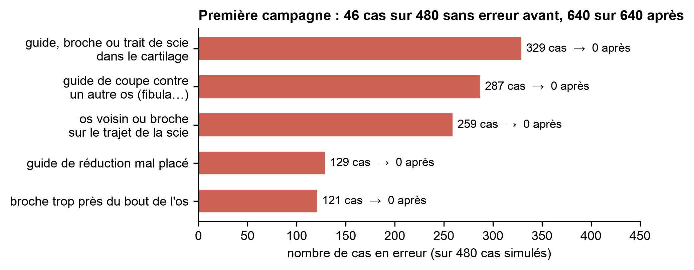{width=100%}

# Limites

Nos résultats sont valables dans le cadre de nos hypothèses :

- **un seul chien, et il est sain** : les déformités sont simulées. Un os très déformé, un implant ou un petit chien
  pourraient tromper la détection des repères ;
- **fémur : seulement les déformités près du genou** (zone tordue entre 62 et 82 % de la longueur de l'os). Les
  déformités du haut du fémur (col, hanche) se corrigent par une autre opération et sortent du projet ;
- **une seule zone tordue par os** : les os tordus à deux endroits ne sont pas traités ;
- **seulement des coupes droites** : pas d'ostéotomie en dôme (coupe courbe) [16] ; l'angle et la torsion sont corrigés
  par un coin puis une rotation ;
- **les valeurs normales** sont surtout publiées pour quelques races (Labrador, berger allemand…) et mesurées sur
  radiographie ;
- **les voies d'abord et les marges de sécurité** sont des choix raisonnés, qui doivent encore être validés par un
  chirurgien ;
- **les muscles, les ligaments et la plaque** ne sont pas modélisés ;
- **les guides n'ont pas encore été imprimés ni essayés** : le jeu réel à l'impression et la tenue à la stérilisation
  restent inconnus ;
- l'application autonome existe **seulement pour Mac**.

# Suite du projet

1. **Imprimer et essayer** : imprimer d'abord de petites pièces de test pour régler le jeu des fentes et des trous,
   puis des guides sur des os imprimés, et mesurer l'erreur finale.
2. **Vrais cas** : obtenir des scanners de chiens malades, rendus anonymes, et comparer nos planifications à celles du
   chirurgien.
3. **Robustesse** : tester d'autres scanners et d'autres races, et utiliser la patte opposée comme référence quand elle
   a été scannée.
4. **Nouvelles fonctions** : une plaque sur mesure dont les trous de vis sont percés à travers le guide [14], les os
   tordus à deux endroits, une application autonome pour Windows.
5. **Sécurité des données** : mieux protéger l'application sur l'ordinateur et ne plus recopier le nom de l'animal dans
   les rapports (voir la documentation technique).

# Conclusion

CT-CORA3D relie, dans une seule application, le scanner d'une patte de chien à deux guides prêts à imprimer. La
segmentation, les repères, la méthode CORA en 3D, le choix de la stratégie et la construction des guides se font
automatiquement, et chaque étape est expliquée à l'écran. Sur des cas simulés, le calcul est exact à quelques millièmes
de degré, et plus de 1 300 cas passent tous nos contrôles. La prochaine étape n'est plus seulement informatique :
il faut imprimer les guides, les essayer et comparer nos propositions à celles d'un chirurgien sur de vrais patients.

# Références {-}

1. Paley D. *Principles of Deformity Correction*. Springer, 2002. doi:10.1007/978-3-642-59373-4
2. Tomlinson J, Fox D, Cook JL, Keller GG. Measurement of femoral angles in four dog breeds. *Vet Surg* 2007;36:593–598.
3. Dismukes DI, Tomlinson JL, Fox DB, Cook JL, Song KJ. Radiographic measurement of the proximal and distal mechanical
   joint angles in the canine tibia. *Vet Surg* 2007;36:699–704.
4. Vezzoni L, Forzisi I, Ferretti A, Vezzoni A. Hemiepiphysiodesis for the correction of distal femoral valgus in
   growing dogs. *Vet Comp Orthop Traumatol* 2022;35(2):112–118.
5. Olsen AM, Vezzoni L, Ferretti A, et al. Hemiepiphysiodesis for the correction of proximal tibial valgus in growing
   dogs. *Vet Comp Orthop Traumatol* 2016;29(4):330–337.
6. Kim SY, Snowdon KA, DeCamp CE. Single oblique osteotomy for correction of antebrachial angular and torsional
   deformities in a dog. *J Am Vet Med Assoc* 2017;251(3):333–339.
7. Petazzoni M, Nicetto T, Vezzoni A, Piras A, Palmer R. Treatment of pes varus using locking plate fixation in seven
   Dachshund dogs. *Vet Comp Orthop Traumatol* 2012;25(3):231–238.
8. Brower BE, Kowaleski MP, Peruski AM, et al. Distal femoral lateral closing wedge osteotomy as a component of
   comprehensive treatment of medial patellar luxation and distal femoral varus in dogs. *Vet Comp Orthop Traumatol*
   2017;30(1):20–27.
9. Worth AJ, Crosse KR, Kersley A. Computer-assisted surgery using 3D printed saw guides for acute correction of
   antebrachial angular limb deformities in dogs. *Vet Comp Orthop Traumatol* 2019;32(3):241–249.
10. Hall EL, Baines S, Bilmont A, Oxley B. Accuracy of patient-specific three-dimensional-printed osteotomy and
    reduction guides for distal femoral osteotomy in dogs with medial patella luxation. *Vet Surg* 2019;48(4):584–591.
11. De Armond CC, Lewis DD, Kim SE, Biedrzycki AH. Accuracy of virtual surgical planning and custom three-dimensionally
    printed osteotomy and reduction guides for acute uni- and biapical correction of antebrachial deformities in dogs.
    *J Am Vet Med Assoc* 2022;260(13):1–9.
12. Jeon JW, Kang KW, Kim WK, Jung C, Kang BJ. Three-dimensional-printed patient-specific guides for tibial deformity
    correction in small-breed dogs. *Am J Vet Res* 2023;84(12).
13. Bright S, Schofield I, Oxley B. Surgical correction of pes varus deformity in dachshunds using three-dimensional-
    printed patient-specific guide system: nine tibiae in seven cases (2018–2022). *J Small Anim Pract*
    2024;65(12):894–905.
14. Carwardine DR, Gosling MJ, Burton NJ, O'Malley FL, Parsons KJ. Three-dimensional-printed patient-specific osteotomy
    guides, repositioning guides and titanium plates for acute correction of antebrachial limb deformities in dogs.
    *Vet Comp Orthop Traumatol* 2021;34(1):43–52.
15. Al Aiyan A, Richardson K, Manchi G, Ginja M, Brunnberg L. Measurement of the femoral anteversion angle in medium
    and large dog breeds using computed tomography. *Front Vet Sci* 2021;8:540406.
16. Fox DB, Tomlinson JL, Cook JL, Breshears LM. Principles of uniapical and biapical radial deformity correction using
    dome osteotomies and the center of rotation of angulation methodology in dogs. *Vet Surg* 2006;35(1):67–77.
17. Wilke VL, Conzemius MG, Besancon MF, et al. Comparison of tibial plateau angle between clinically normal Greyhounds
    and Labrador Retrievers with and without rupture of the cranial cruciate ligament. *J Am Vet Med Assoc*
    2002;221(10):1426–1429.
18. Projet PMD2. *Planification 3D d'une ostéotomie correctrice du membre pelvien chez le chien* (document de cadrage
    « Best_Position »), 5 octobre 2026.
